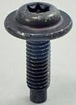
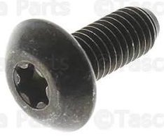

## Винт малый (ближе к центру)

- M5 (уточнить)
- уточнить шаг резьбы
- длина резьбовой части 15 мм
- диаметр шляпки 15 мм

2 шт

__Mazda__ `9YAF60603`

## Винт большой (по краям)

- M6 (уточнить)
- уточнить шаг резьбы
- длина резьбовой части 17 мм
- диаметр шляпки 17 мм

2 шт

__Mazda__ `9YAF30803A`

## Клипса

3 шт

__Mazda__ `GJ1268865`